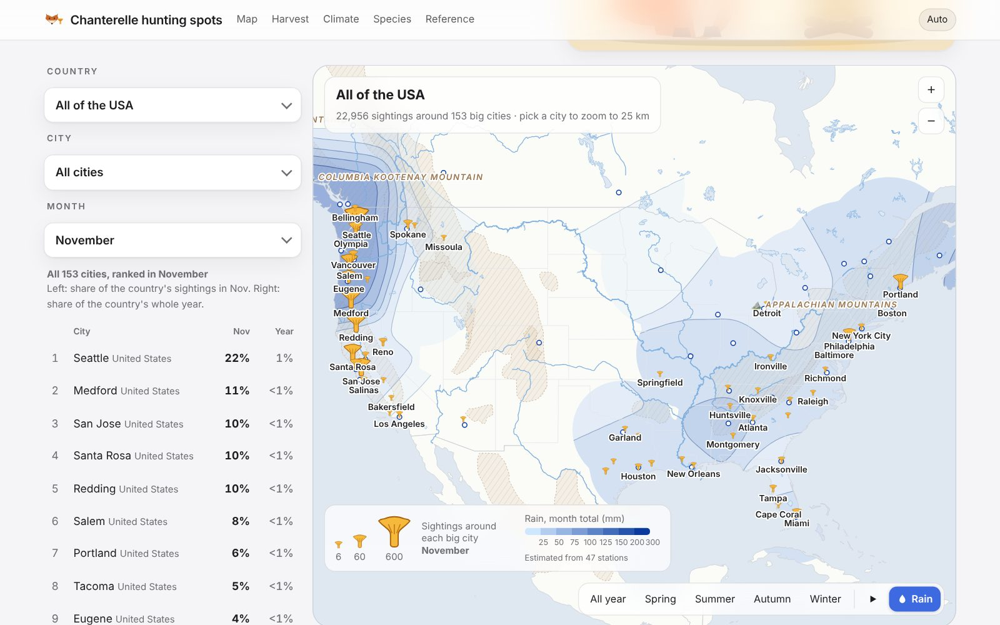
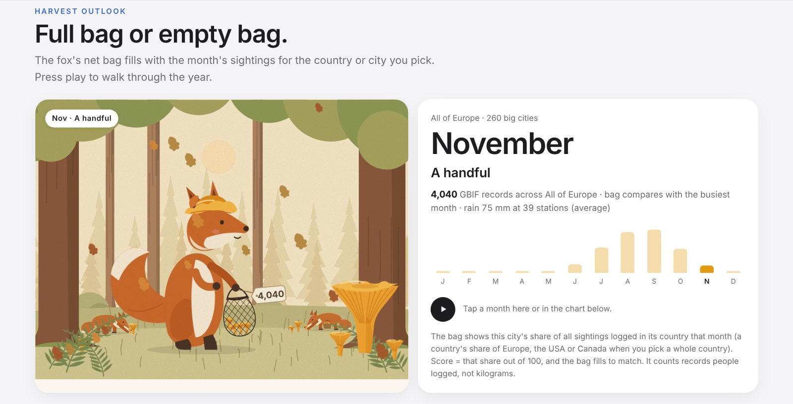
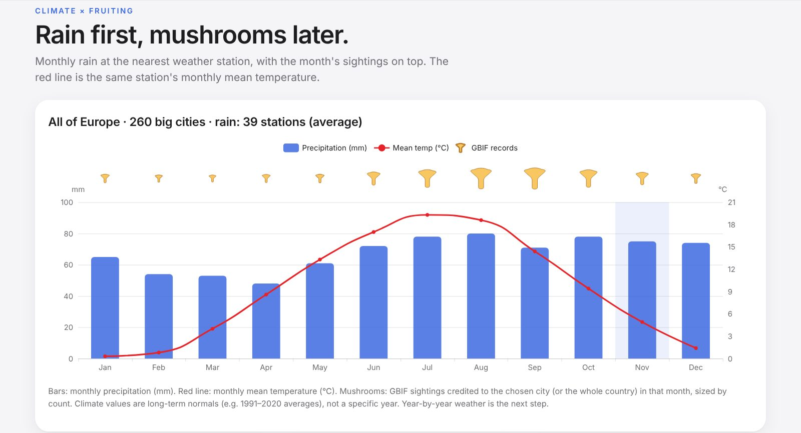

# Chanterelle hunting spots

Where and when golden chanterelles (*Cantharellus*) turn up in Europe, the USA and Canada, and how that lines up with rain and temperature. Draft v1.2.

**Live page:** https://soyounson.github.io/chanterelle-hunting-spots/

| Europe, dark mode | USA, light mode |
|---|---|
|  |  |

## What the page shows

- **Map:** opens on all of Europe for the current month. Pick a country, then a big city, and the map zooms to the 25 km around it. One mushroom per big city, sized by the GBIF chanterelle records around it. Rivers, lakes, mountain ranges, peaks and towns are drawn too, and blue bands are rain contours for the same period.
- **Harvest outlook:** a fox fills a net bag with the records of the city or country you pick. The bag is full in the busiest month and empty when nothing is logged.
- **Climate × Fruiting:** monthly rain normals from the nearest station (and temperature where a featured station is close), with the month's records on top.
- **Reference page** (`reference.html`): the model plan (why, inputs and outputs, training and testing, metrics) and where every data layer comes from and how it was cleaned.

| Harvest outlook | Climate × Fruiting |
|---|---|
|  |  |

## How the numbers are made

| Layer | Method | Status |
|---|---|---|
| City mushrooms | GBIF records counted in 1° × 1.5° grid cells (about 110 km), each cell credited to the largest city of 150,000+ people (60,000+ in Canada) within about 110 km | Estimated |
| Rain contours | Monthly normals from 86 weather stations (mostly 1991–2020), blended by distance (about 180 km reach), blank beyond 450 km from a station | Estimated |
| Rain and temperature chart | Nearest of 86 weather stations, monthly rain and mean temperature normals (mostly 1991–2020) from Wikipedia climate tables | Long-term normals |
| Fox's bag | Score out of 100: the city's share of all records in its country that month (a country's share of its region); the bag fills to the same level | Display only |
| Rivers, lakes, mountains | Natural Earth 1:10m | Map data |

Records show where people found and logged chanterelles, so busy areas also reflect where more people look.

## Files

- `index.html`: the whole page in one file (libraries, map shapes and data are bundled, so it also works offline)
- `reference.html`: model and data reference
- `data/chanterelle_grid.json`: GBIF record counts per grid cell with a month breakdown
- `scripts/fetch_grid_fast.py`: rebuilds the grid file from the GBIF API (Python 3, no extra packages)
- `scripts/fetch_dedup.py`: downloads the records, removes duplicates and rebuilds the grid with a year-month breakdown (not applied to the page yet)

## Sources

- Occurrence data: [GBIF.org](https://www.gbif.org/), genus *Cantharellus* (taxonKey 9623860)
- Climate normals: Wikipedia climate tables (national weather services)
- Cities: GeoNames via the `all-the-cities` package
- Map: Natural Earth borders, rivers, lakes and mountains, US Census outlines (world-atlas, us-atlas), D3
- Charts: Apache ECharts

## License

Code is MIT and the original text, maps and screenshots are CC BY 4.0 (see [LICENSE](LICENSE)). GBIF records and the other sources above keep their own terms.

Check with a local expert before eating anything you pick.
