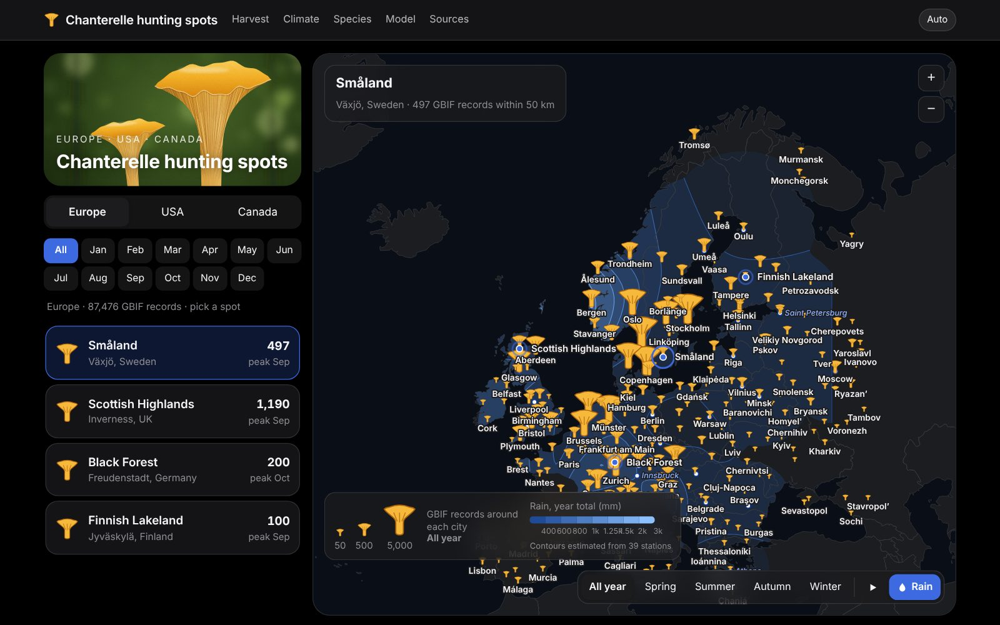

# Chanterelle hunting spots

Where and when golden chanterelles (*Cantharellus*) turn up in Europe, the USA and Canada, and how that lines up with rain and temperature. Draft v1.1.

**Live page:** https://soyounson.github.io/chanterelle-hunting-spots/

## What the page shows

- **Map:** one mushroom per city, sized by the GBIF chanterelle records in the forests around it. Pick a month or season to see how the picture shifts. Blue bands are rain contours for the same period.
- **Harvest outlook:** a fox fills a net bag with the records of the spot or city you tap. The bag is full in the busiest month and empty when nothing is logged.
- **Climate × Fruiting:** monthly rain and temperature normals for each spot, with the month's records on top.
- **Model plan:** the next step, predicting this year's chance of chanterelles from the previous months' weather.

## How the numbers are made

| Layer | Method | Status |
|---|---|---|
| City mushrooms | GBIF records counted in 1° × 1.5° grid cells (about 110 km), each cell credited to the largest city of 40,000+ people within about 110 km | Estimated |
| Rain contours | Monthly normals from 86 weather stations (mostly 1991–2020), blended by distance (about 180 km reach), blank beyond 450 km from a station | Estimated |
| Spot climate | One weather station per spot, Wikipedia climate tables | Long-term normals |
| Fox's bag | The chosen month's records divided by the spot's busiest month | Display only |

Records show where people found and logged chanterelles, so busy areas also reflect where more people look.

## Files

- `index.html`: the whole page in one file (libraries, map shapes and data are bundled, so it also works offline)
- `data/chanterelle_grid.json`: GBIF record counts per grid cell with a month breakdown
- `scripts/fetch_grid_fast.py`: rebuilds the grid file from the GBIF API (Python 3, no extra packages)

## Sources

- Occurrence data: [GBIF.org](https://www.gbif.org/), genus *Cantharellus* (taxonKey 9623860)
- Climate normals: Wikipedia climate tables (national weather services)
- Cities: GeoNames via the `all-the-cities` package
- Map: Natural Earth and US Census outlines (world-atlas, us-atlas), D3
- Charts: Apache ECharts

## License

Code is MIT and the original text, maps and screenshots are CC BY 4.0 (see [LICENSE](LICENSE)). GBIF records and the other sources above keep their own terms.

Check with a local expert before eating anything you pick.
